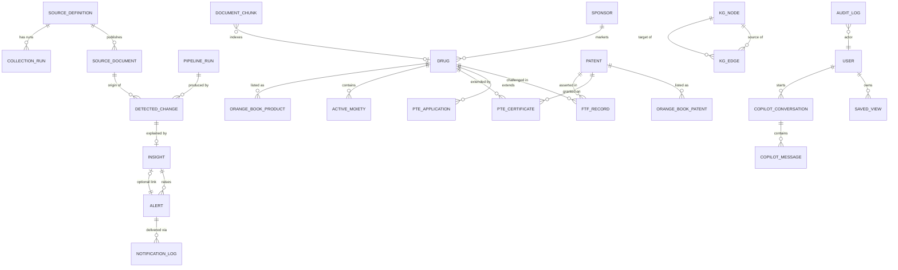

# Data Model

All tables are defined in `backend/app/db/models.py`. Every table carries a
UUID primary key and `created_at` / `updated_at` timestamps via the
`UUIDPrimaryKey` and `TimestampMixin` mixins.

## Conventions

| Pattern | Meaning |
| --- | --- |
| `source_code` | Which configured source this row came from (see `app/collectors/registry.py`) |
| `source_key` | Natural key, stable across published versions — the diff anchor |
| `content_hash` | SHA-256 of the comparable payload; equal hash ⇒ no change |
| `first_seen_at` / `last_seen_at` | Lifecycle of the row as observed on the source |
| `is_active` | False once the record disappears from the source (never deleted) |
| `is_baseline` | On a change row: part of the first-ever snapshot ⇒ no alert |
| `processed` | On a change row: already analyzed by the impact engine |

## Entity map

## Tables by domain

### Source registry and lineage

| Table | Purpose |
| --- | --- |
| `source_definitions` | One row per configured source: URL, cadence, locator strategy, and health (`last_checked_at`, `last_success_at`, `last_error`) |
| `source_documents` | Immutable artifact versions. `is_current` marks the live edition; `version` increments per change |
| `collection_runs` | One fetch attempt for one source: status, duration, record counts, error |
| `pipeline_runs` | One end-to-end sweep across all sources: aggregate counts |

### Change history

| Table | Purpose |
| --- | --- |
| `detected_changes` | The event log. One row per added/updated/removed record, with `field_changes`, `before`, `after`, and version links |

`detected_changes.document_id` / `previous_document_id` link the new and old
source documents, enabling the before/after comparison endpoint.

### Regulatory fact tables

Each follows the versioned-row pattern (`source_key`, `content_hash`,
`is_active`).

| Table | Module | Key natural identifier |
| --- | --- | --- |
| `ftf_records` | FTF | drug + form + strength + NDA |
| `pte_applications` | PTE | application number / patent number |
| `pte_certificates` | PTE | patent number + granted date |
| `active_moieties` | PDE | moiety name + NDA |
| `orange_book_products` | Orange Book | appl type + appl no + product no |
| `orange_book_patents` | Orange Book | appl + product + patent number |
| `orange_book_exclusivity` | Orange Book | appl + product + exclusivity code |
| `orange_book_supplements` | Orange Book | supplement number / edition |

### Canonical entities (knowledge graph backing)

| Table | Purpose |
| --- | --- |
| `sponsors` | Normalized companies with `importance_score` and aliases |
| `drugs` | Canonical products with therapy area, ingredient, RLD NDA |
| `patents` | Normalized patent records with flags (substance, product, use code, PTE, Paragraph IV), family id, litigation |
| `active_moieties` | Also references the canonical drug and sponsor |

Fact rows reference these through nullable foreign keys (`drug_id`,
`patent_id`, `sponsor_id`), populated by the entity-resolution step. This is
what lets one search return every module's records for a product.

### Knowledge graph

| Table | Purpose |
| --- | --- |
| `kg_nodes` | Typed nodes: `node_type`, `natural_key`, `label`, and a pointer back to the source row (`ref_table`, `ref_id`) |
| `kg_edges` | Typed relationships with weight and properties |

### Intelligence and alerting

| Table | Purpose |
| --- | --- |
| `insights` | The AI impact analysis: `what_changed`, `why_it_matters`, `affected_companies`, `affected_products`, `generic_opportunity`, `exclusivity_risk`, `recommended_action`, `priority_score`, `priority_label`, `score_breakdown` |
| `alerts` | Actionable notifications with a unique `dedupe_key`, priority, status, and channel log |
| `notification_logs` | Per-channel delivery attempts and outcomes |

### Platform

| Table | Purpose |
| --- | --- |
| `users` | Accounts with `role` (admin, analyst, regulatory_affairs, ip_counsel, executive, viewer) |
| `saved_views` | Persisted dashboard filter sets and custom dashboards |
| `audit_logs` | Actor, action, resource, status, IP, and detail for every sensitive operation |
| `copilot_conversations` / `copilot_messages` | Copilot threads with citations and latency |
| `document_chunks` | RAG corpus: text chunks with embeddings for semantic search |

## Indexing

- Natural keys: unique composite on `(source_code, source_key, content_hash)`.
- Change history: index on `(module, detected_at)` and `(processed)`.
- Alerts: unique `dedupe_key`; index on `(status, priority_score)`.
- Full text: PostgreSQL `pg_trgm` GIN indexes on drug and sponsor names
  (enabled by `deploy/postgres/init/01-extensions.sql`).
- Vector: pgvector index on `document_chunks.embedding` for cosine search.

## Migrations

`scripts/bootstrap.py` runs `create_all` plus an additive-column reconcile
(`reconcile_schema`), which adds new health or tracking columns to an existing
database without dropping data. Alembic is present for destructive or
data-backfill migrations.
